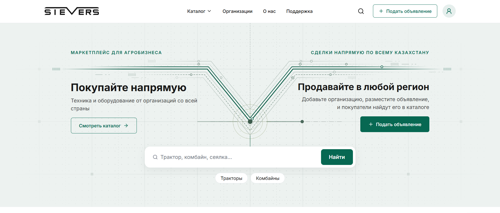
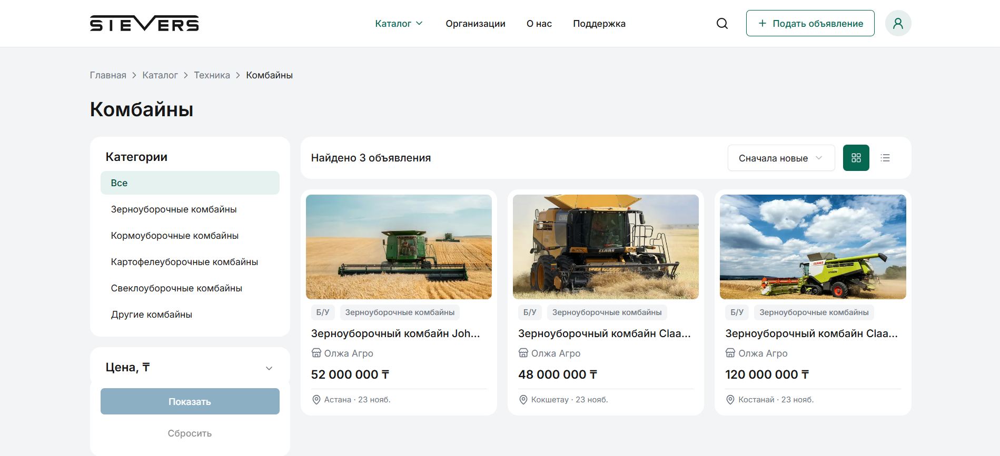
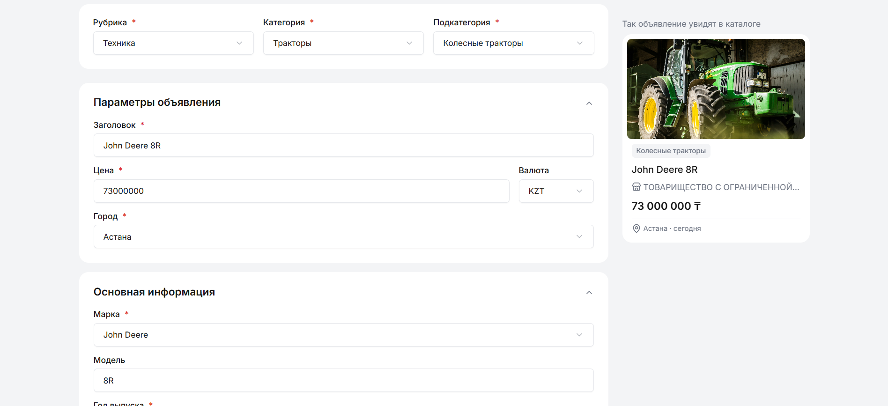

# Sievers Market — frontend

Веб-клиент B2B-маркетплейса сельхозтехники и оборудования для Казахстана. Организации размещают объявления о продаже техники, покупатели ищут их по каталогу с фильтрами.

**Живая версия:** [market.sievers.kz](https://market.sievers.kz)

## Скриншоты
Главная, каталог и форма подачи объявления (production).







## Возможности
- Главная, каталог по рубрикам и подкатегориям, поиск по сайту.
- Фильтры каталога: цена, город, характеристики по категории (справочники, числовые диапазоны), сортировка, пагинация.
- Страница объявления: галерея, характеристики, данные организации-продавца, контакты.
- Каталог организаций.
- Регистрация и вход, подтверждение почты кодом, смена почты и пароля.
- Личный кабинет: организации (добавление по БИН/ИИН, проверка по реестру), объявления организации, действия над ними (активировать, деактивировать, в архив, удалить).
- Создание объявления: выбор категории, динамическая форма по характеристикам, загрузка фото.

## Технологии
Next.js 16 (App Router), React 19, TypeScript (strict), Tailwind CSS 4, shadcn/ui (Radix), react-hook-form и Zod, нативный `fetch`, `openapi-typescript`. Деплой: Vercel.

## Как устроен проект
```
src/app/         маршруты и layout: только точки входа
src/components/  компоненты по областям: catalog, listing, account, auth, home…
src/components/ui/  примитивы shadcn/ui
src/lib/api/     весь доступ к бэкенду
src/hooks/       клиентские хуки
docs/pages/      спецификации экранов
```

Основные решения:
- **Сессия через прокси.** Вход работает на httpOnly-cookie, токенов в JavaScript нет. Браузер ходит на свой домен `/api/v1/...`, а `rewrites` в `next.config.ts` передаёт запросы бэкенду, поэтому cookie живут на домене фронтенда и доходят до серверных компонентов.
- **Один клиент API.** Все запросы идут через `apiFetch` (`src/lib/api/client.ts`): он добавляет заголовок `X-Client-Type: web`, на сервере пробрасывает cookie, в браузере при ответе 401 один раз обновляет токен, даже если запросов несколько.
- **Типы из OpenAPI.** Типы ответов не пишутся руками: `npm run gen:api` генерирует их из схемы бэкенда. Схемы форм на Zod повторяют DTO бэкенда.
- **Ошибки.** Бэкенд отдаёт ошибки в двух форматах (`error_code` и стандартный 422). Клиент приводит их к одному `ApiError`, а `applyApiErrorToForm` раскладывает по полям формы.
- **Загрузка фото.** Запрос pre-signed URL у бэкенда, затем PUT файла напрямую в MinIO, затем подтверждение загрузки.
- **Серверные компоненты по умолчанию.** `"use client"` только там, где нужны состояние или обработчики. Справочники (дерево категорий, города, марки) читаются на сервере с кэшем.
- **SEO.** `robots.txt` и `sitemap.xml`, canonical, Open Graph и иконки через файловые соглашения Next. Staging и preview закрыты от индексации (`Disallow: /`), индексируется только production.

## Окружения и процесс
- Два окружения на Vercel: **production** (ветка `main`, `market.sievers.kz`) и **staging** (ветка `dev`), недоступный извне: Vercel просит войти в аккаунт, поэтому по ссылке на staging посторонний попадёт на страницу входа Vercel, а не на сайт. Дополнительно staging закрыт от поисковиков.
- Фича делается в ветке `feature/<экран>` от `dev`, затем PR в `dev`; релиз — PR из `dev` в `main`.
- Перед PR проходят `typecheck`, `lint` и `build`.

## Как разрабатывался
Код фронтенда написан ИИ-агентом (Claude Code) по спецификациям экранов из [`docs/pages/`](./docs/pages). Дизайн сделан по моим макетам и дорабатывался в ходе разработки. Архитектуру, контракты с бэкендом и приёмку результата веду я. Правила для агента лежат в [`CLAUDE.md`](./CLAUDE.md), а [`docs/STATUS.md`](./docs/STATUS.md) хранит состояние проекта и принятые решения между задачами.

## Запуск
```bash
nvm use            # Node из .nvmrc (22)
npm install
cp .env.example .env.local
npm run dev
```

Переменные окружения:

| Переменная | Назначение |
|---|---|
| `BACKEND_URL` | адрес бэкенда для прокси `/api/v1` и серверных запросов (только сервер, читается при сборке) |
| `NEXT_PUBLIC_API_URL` | публичный адрес API для картинок |
| `NEXT_PUBLIC_SITE_URL` | публичный адрес сайта для canonical, sitemap и Open Graph |

## Скрипты
| Команда | Что делает |
|---|---|
| `npm run dev` | dev-сервер |
| `npm run typecheck` | генерация типов Next и `tsc` |
| `npm run lint` | ESLint |
| `npm run build` | production-сборка |
| `npm run gen:api` | типы из OpenAPI бэкенда в `src/lib/api/schema.d.ts` (другой адрес: `OPENAPI_URL=... npm run gen:api`) |

## Связанные репозитории
- [`sievers-market-backend`](https://github.com/sievers-kz/sievers-market-backend): REST API на FastAPI, PostgreSQL.
- [`sievers-infra`](https://github.com/sievers-kz/sievers-infra): инфраструктура и деплой бэкенда (nginx, Docker Compose, CD).
